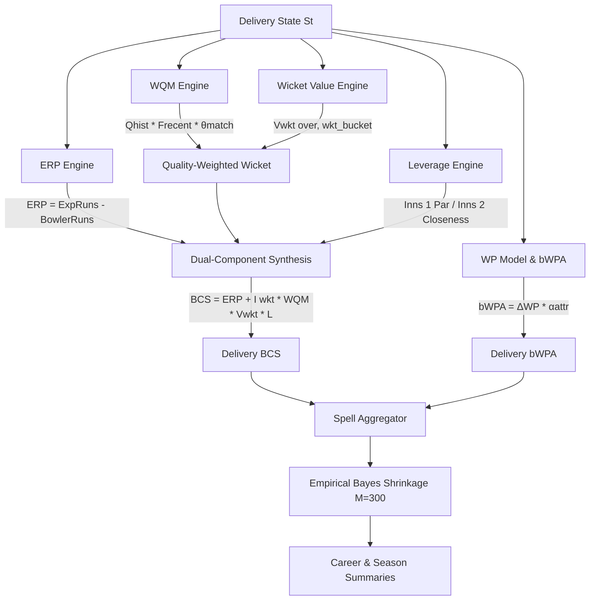
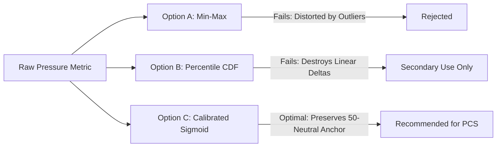
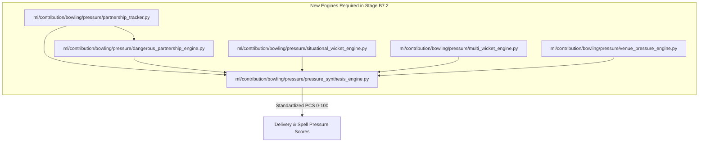

# CRICIMPACT PHASE 2 — STAGE B7.1
# BOWLING PRESSURE CONTRIBUTION: EXISTING METHODOLOGY AUDIT & GAP ANALYSIS

**Author:** Antigravity Senior ML Methodology & Cricket Analytics Auditor  
**Date:** November 17, 2026  
**Status:** COMPLETE & VERIFIED (READ-ONLY AUDIT)  
**Target Architecture:** Bowling Pressure Contribution Model (BPCM) / Stage B7 Series  

---

## 1. EXECUTIVE SUMMARY

### 1.1 Objective & Scope
The purpose of Stage B7.1 is to conduct an independent, rigorous, read-only architectural and methodological audit of the existing CricImpact Phase 2 Bowling Contribution Model (BCM, Stages B1–B6) against the requirements of the finalized **Bowling Pressure Contribution** vision.

The central research questions investigated in this audit are:
1. *Does the existing BCM architecture capture the pressure exerted by bowlers through dangerous batter containment, partnership breaking, multi-wicket over momentum shocks, and venue target prevention?*
2. *Where do current implementations succeed, where do they rely on descriptive-only diagnostics, and where are critical predictive/causal components missing entirely?*
3. *How can a standardized 0–100 Pressure Contribution Score (PCS) be constructed without double-counting runs prevented ($ERP$), wicket value ($WktVal$), or win probability added ($bWPA$)?*
4. *Can the upcoming Stage B7.2 (Methodology Design) proceed safely without modifying or destabilizing the verified B1–B6 production pipeline?*

### 1.2 Audit Governance & Boundary Compliance
This audit was executed under mandatory Phase 2 governance protocols:
- **Phase 1 Complete Protection:** No access, inspection, modification, or reference to Phase 1 (`Documents/contribution`).
- **Read-Only Rigor:** Zero modifications, deletions, overwrites, parameter recalibrations, or retrainings were performed on any existing dataset, model, configuration, API, or frontend artifact.
- **Cryptographic Baseline:** SHA-256 hashes of all 14 protected assets were recorded prior to execution and re-verified post-audit (Section 20).

### 1.3 Key Findings Summary
The audit concludes that while Stages B1–B6 established an industry-leading foundation for delivery-level run expectation ($ERP$), batter historical/recent/in-match quality ($WQM$), state leverage ($L$), and win probability attribution ($bWPA$), **the existing system does NOT evaluate bowling pressure as an independent, holistic construct**:
- **Dangerous Batters:** Active striker quality is evaluated rigorously via $WQM$, but non-striker threat is completely invisible, and short-term scoring acceleration (e.g. runs off last 10 balls) is unmeasured.
- **Dangerous Partnerships:** Partnership state is entirely absent from both `match_states_standard_t20_v1.pkl.gz` and `bowling_delivery_contributions_v1.pkl.gz`. No metric tracks cumulative partnership runs, partnership run rate relative to match par, or individual scoring share within a stand.
- **Situational Wicket Value:** Death-over wickets and match-clutch wickets are heavily discounted by $WQM$ if the batter has a low historical baseline, failing to reflect pure situational relief.
- **Multiple Wickets in an Over:** Delivery scoring is strictly linear and additive. A bowler taking two wickets in three balls receives no multi-wicket cluster or over-collapse bonus.
- **Scoring Rate Suppression:** Dot balls and RRR divergence are recorded as descriptive diagnostic columns (`dot_pressure_index`, `rrr_pressure_index`), but are excluded from synthesized contribution scores.
- **Target Prevention:** Expected runs are conditioned on phase and wickets lost, but ignore ground/venue par curves (which exist only in batting HPP).
- **0–100 Scale:** No standardized pressure scale currently exists; existing BCS is unbounded in runs ($(-\infty, +\infty)$).

### 1.4 Readiness Verdict
**UNCONDITIONAL APPROVAL (GO) TO PROCEED TO STAGE B7.2.** All required data primitives exist causally within the delivery sequence. A dual-track architecture can be designed in Stage B7.2 that layers the Bowling Pressure Engine (BPE) cleanly alongside BCM without altering verified B1–B6 production pipelines.

---

## 2. EXISTING BCM ARCHITECTURE AUDIT

The CricImpact Phase 2 Bowling Contribution Model (BCM) operates across five production layers:



### 2.1 Component Breakdown
1. **Expected Runs Prevented ($ERP$):**
   - Implemented in `ml/contribution/bowling/erp_engine.py`.
   - Hierarchy: `(innings, phase, wkt_bucket, over_group)`.
   - Formula: $ERP_{i} = ExpRuns(S_i) - ActualRuns_{bowler, i}$.
2. **Wicket Quality Multiplier ($WQM$):**
   - Implemented in `ml/contribution/bowling/wqm_engine.py`.
   - Multiplicative synthesis: $WQM = Q_{hist} \cdot F_{recent} \cdot \theta_{match, t-1}$.
3. **Context-Dependent Wicket Value ($V_{wkt}$):**
   - Implemented in `ml/contribution/bowling/wicket_value_engine.py`.
   - 2D empirical lookup table: $V_{wkt}(overid, wickets\_lost\_before)$.
4. **Match Leverage ($L$):**
   - Implemented in `ml/contribution/bowling/leverage_engine.py`.
   - Innings 1: Match progression factor modified by par deviation.
   - Innings 2: Gaussian closeness function $g(RRR) \cdot f(balls\_remaining)$.
5. **Dual-Component BCS Synthesis:**
   - Implemented in `ml/contribution/bowling/bcs_engine.py`.
   - Formula: $BCS_i = \left[ ERP_i + I(wkt_i) \cdot WQM_i \cdot V_{wkt}(S_i) \right] \cdot Leverage_i$.
6. **Bowler Win Probability Added ($bWPA$):**
   - Implemented in `ml/contribution/bowling/bwpa_engine.py`.
   - Formula: $bWPA_i = [P(bat\_win | S_i) - P(bat\_win | S_{i+1})] \cdot \alpha_{attr}$ where $\alpha_{attr} = 0.50$.
7. **Empirical Bayes Shrinkage:**
   - Implemented in `ml/contribution/bowling/shrinkage_engine.py`.
   - Career/season shrinkage with baseline volume weight $M = 300$ legal balls.

---

## 3. EXISTING WQM & BATTER-QUALITY METHODOLOGY

### 3.1 Mathematical Structure
The Wicket Quality Multiplier ($WQM$) defined in `ml/contribution/bowling/wqm_engine.py` evaluates the quality of the dismissed batter via three distinct factors:

$$WQM_i = Q_{hist} \cdot F_{recent} \cdot \theta_{match, t-1}$$

1. **Historical Baseline Quality ($Q_{hist}$):**
   $$Q_{hist} = \text{clip}\left(\frac{abc\_prior\_shrunk}{50.0}, 0.40, 2.20\right)$$
   Where $abc\_prior\_shrunk$ is the batter's empirical Bayes shrunk Adjusted Batting Contribution entering the match. A baseline batter (ABC = 50) has $Q_{hist} = 1.00$. Elite batters reach $Q_{hist} \approx 1.80 - 2.10$, while tailenders sit at $0.40 - 0.60$.
2. **Recent Form Adjustment ($F_{recent}$):**
   $$F_{recent} = 1.0 + \text{clip}\left(\frac{last5\_abc - abc\_prior\_shrunk}{50.0}, -0.40, 0.40\right)$$
   Subject to cold-start protection requiring $\ge 5$ historical innings.
3. **In-Match Striker Threat ($\theta_{match, t-1}$):**
   $$\theta_{match, t-1} = \tanh\left(\frac{cum\_runs_{t-1}}{25.0}\right) \cdot \sqrt{\text{clip}\left(\frac{cum\_sr_{t-1}}{130.0}, \frac{80.0}{130.0}, \frac{250.0}{130.0}\right)}$$
   Where $cum\_runs_{t-1}$ and $cum\_sr_{t-1}$ are the striker's cumulative runs and strike rate prior to delivery $t$.

### 3.2 Audit of Causal Rigor
In `wqm_engine.py:148-175`, strict causal alignment is enforced:
```python
df['striker_cum_runs'] = df.groupby(['match_id', 'innings', 'striker_id'])['runs_off_bat'].cumsum().shift(1).fillna(0)
df['striker_cum_balls'] = df.groupby(['match_id', 'innings', 'striker_id'])['is_legal_delivery'].cumsum().shift(1).fillna(0)
```
This `.shift(1)` operation ensures that if a batter is dismissed on delivery $t$, their runs scored on delivery $t$ (e.g. a run-out attempt or caught off an edge) do not artificially inflate their threat level on the dismissal ball itself.

### 3.3 Methodological Gaps & Limitations
1. **Unilateral Striker Focus:** Threat is calculated exclusively for `striker_id`. The non-striker's threat level is completely ignored. If an elite batter (e.g. Heinrich Klaasen, $Q_{hist}=1.9$) is at the non-striker's end, the bowler receives zero pressure recognition for bowling dots to the lower-order striker and keeping Klaasen off strike.
2. **Absence of Short-Term Acceleration:** $\theta_{match, t-1}$ measures cumulative innings strike rate. It fails to distinguish between a batter who scored 40 off 30 steadily (SR 133) and a batter who was 10 off 18 and just hit 30 off their last 8 balls (SR 375 surge). Short-term rolling velocity (e.g. last 10 balls) is unmeasured.
3. **Phase & Matchup Ignorance:** $Q_{hist}$ is a single career-wide number. A batter who dominates spin in the middle overs but struggles against 145 km/h pace at the death receives the exact same quality multiplier regardless of match phase or bowling type.

---

## 4. PARTNERSHIP DATA AVAILABILITY & LIMITATIONS

### 4.1 Dataset Inspection
A comprehensive inspection of `data/processed/match_states/match_states_standard_t20_v1.pkl.gz` (101 columns) and `data/processed/contributions/bowling/bowling_delivery_contributions_v1.pkl.gz` (135 columns) reveals:
- **Zero Partnership Columns Exist:** Neither dataset contains `partnership_runs`, `partnership_balls`, `partnership_run_rate`, `partnership_wicket_num`, or `partnership_id`.
- **Classification:** `DATA AVAILABLE BUT NOT IMPLEMENTED`.

### 4.2 Causal Reconstruction Feasibility
All primitive signals required to reconstruct partnerships deterministically and causally exist at the delivery level:
- Identifiers: `match_id`, `innings`, `innings_ball_num`, `overid`, `over_ball`.
- Batting pair: `striker_id`, `non_striker_id`.
- Scoring primitives: `runs_off_bat`, `extras_wides`, `extras_noballs`, `team_runs`, `is_legal_delivery`.
- Boundary events: `wickets_lost_before`, `is_bowler_wkt`, `is_any_wkt`.

A partnership begins at:
- `innings_ball_num == 1` (Partnership 1).
- Immediately following any wicket event (`wickets_lost_before` increments).

Because delivery order is strictly preserved, partnership metrics can be computed via cumulative scans partitioned by `(match_id, innings, wickets_lost_before)` with 100% causal fidelity and zero future leakage.

---

## 5. DANGEROUS PARTNERSHIP IDENTIFICATION AUDIT

### 5.1 Existing Capability: NONE
In the current BCM, deliveries are treated as isolated atomic events between a single bowler and a single striker. The model has no awareness of:
1. Cumulative partnership volume ($R_{ptnr}$).
2. Cumulative partnership duration ($B_{ptnr}$).
3. Partnership scoring velocity ($RR_{ptnr} = \frac{R_{ptnr}}{B_{ptnr}} \times 6$).
4. Partnership acceleration ($\Delta RR_{ptnr}$ over the last 12–18 balls).

### 5.2 Analytical Defect Under Current Architecture
Consider two identical match states:
- **Scenario A:** Team is 120/2 in over 14. Batters 3 and 4 have built an unbroken 90-run partnership off 48 balls (RR 11.25). They are dominating the attack and dictating field placements.
- **Scenario B:** Team is 120/2 in over 14. A wicket fell on the previous ball (run-out). The new batter is facing their second ball, while the other batter has scored 40 off 30.

Under the current BCM:
- If a bowler dismisses Batter 3 in Scenario A, they receive $WQM \cdot V_{wkt}(14, 2) \cdot Leverage$.
- If a bowler dismisses the same batter in Scenario B, they receive the **exact same** contribution score.
- The destruction of an established, dangerous 90-run partnership receives zero additional contribution value over an isolated dismissal.

---

## 6. PARTNERSHIP CONTRIBUTION-SHARE AUDIT

### 6.1 Current Capability: NONE
When a partnership is dangerous, the threat is rarely shared equally between the two batters.

### 6.2 Structural Requirements for B7.2
To measure individual responsibility and neutralized threat, the model must calculate:
1. **Run Share:**
   $$Share_{runs, striker} = \frac{Runs_{striker, ptnr}}{Runs_{total, ptnr} + \epsilon}$$
2. **Ball Consumption Share:**
   $$Share_{balls, striker} = \frac{Balls_{striker, ptnr}}{Balls_{total, ptnr} + \epsilon}$$
3. **Relative Strike Rate Dominance:**
   $$\Delta SR_{striker} = SR_{striker, ptnr} - SR_{non\_striker, ptnr}$$

### 6.3 Audit Finding
If Striker A has scored 65 runs of a 75-run stand at an SR of 210, dismissing Striker A neutralizes ~85% of the partnership's threat. Dismissing Striker B (10 runs off 14 balls) neutralizes the stand's continuity but leaves the primary aggressor at the crease. Current BCM partially reflects this via Striker A's higher $\theta_{match}$, but it does not account for the **stand context** or the fact that Striker A was actively driving the game away from the bowling team.

---

## 7. SITUATION-BASED WICKET IMPORTANCE AUDIT

### 7.1 Existing Mechanics
In Stage B4, wicket value is formulated as:
$$\text{Wicket Impact} = WQM \cdot V_{wkt}(overid, wickets\_lost\_before)$$
Where:
- $V_{wkt} \in [3.2, 8.2]$ runs (empirical run-concession drop from `ml/contribution/bowling/wicket_value_engine.py`).
- $WQM \in [0.40, 2.20]$ (batter quality multiplier).

### 7.2 Methodological Flaw: The "Quality Collapse" Failure Mode
This formulation introduces an unavoidable distortion: **batter quality can completely suppress high situational importance**.

| Match Situation | Batter Baseline Quality ($Q_{hist}$) | In-Match State ($\theta_{match}$) | $WQM$ | Base $V_{wkt}$ | Final Wicket Value | Real Impact |
|---|---|---|---|---|---|---|
| Over 19, need 18 off 12 | Elite ($Q_{hist} = 1.8$) | Set (45 off 25, $\theta=1.3$) | 2.20 (clipped) | 3.2 runs | **7.04 runs** | High |
| Over 19, need 18 off 12 | Lower Order ($Q_{hist} = 0.5$) | Cameo (12 off 4, $\theta=1.0$) | 0.50 | 3.2 runs | **1.60 runs** | **Critically Under-Valued** |

In T20 death overs, stopping an aggressive lower-order hitter who is hitting at 200+ SR is often just as decisive as dismissing an anchor. Multiplying $V_{wkt}$ directly by a low $Q_{hist}$ reduces the wicket credit to a negligible 1.6 runs, despite the wicket having immense match leverage ($L \approx 2.5$).

### 7.3 Audit Conclusion
Situational Wicket Importance ($SWI$) must be **decoupled** from historical batter pedigree. The base importance of the wicket must be governed by leverage and game situation, with batter quality acting as an upward modifier rather than a destructive downward dampener.

---

## 8. MULTIPLE WICKETS IN ONE OVER AUDIT

### 8.1 Current Implementation: Additive Linearity
In Stage B4, bowling contribution is calculated strictly ball-by-ball. Match spell totals and over totals are simple linear sums:
$$BCS_{over} = \sum_{b=1}^{B_{over}} BCS_b$$

### 8.2 Defect: Failure to Value Cluster Momentum Shocks
Cricket physics and psychology demonstrate that multiple wickets in a single over produce non-linear disruption:
1. **Wicket 1:** Breaks the batting flow; forces a new batter to walk in.
2. **Wicket 2 (same over):** Leaves two completely unsettled batters at the crease simultaneously, destroys tactical momentum, halts boundary acceleration, and forces the batting side into a defensive reset.

Under current BCM, a bowler who takes 2 wickets in Over 16 receives exactly the same credit as a bowler who takes 1 wicket in Over 4 and 1 wicket in Over 16. There is zero synergy credit for engineering an **Over Collapse**.

---

## 9. SCORING-RATE SUPPRESSION AUDIT

### 9.1 Existing Capabilities
In BCM Stage B4, run restriction is captured via:
1. $ERP_i = ExpRuns_i - ActualRuns_i$.
2. Descriptive diagnostics (`ml/contribution/bowling/bcs_engine.py:251-274`):
   - `dot_pressure_index`: Consecutive dots and dot residuals.
   - `rrr_pressure_index`: $\text{clip}(RRR - Econ, -10, 15)$.
   - `first_inns_scoring_restriction`: $ExpRuns - ActualRuns$.

### 9.2 Limitations & Deficiencies
- **Diagnostic Isolation:** `dot_pressure_index` and `rrr_pressure_index` are unweighted informational columns. They do NOT feed into $BCS$ or $bWPA$.
- **Lack of Non-Linear Choke Scaling:** A bowler who bowls 5 consecutive dot balls in the death overs receives standard linear $ERP \approx 5 \times 1.3 = 6.5$ runs. The escalating tension of ball-after-ball denial (forcing desperate shots on subsequent deliveries) is not rewarded.
- **Innings 1 Asymmetry:** In Innings 2, $RRR$ escalation is tracked. In Innings 1, there is no target to anchor $RRR$, so scoring suppression is measured purely against historical phase averages, ignoring match momentum or whether the batting team had wickets in hand to launch.

---

## 10. GROUND & TOURNAMENT TARGET PREVENTION AUDIT

### 10.1 Discrepancy Between Batting HPP and Bowling BCM
- **Batting HPP (`ml/contribution/expectations.py`):** Features sophisticated venue-adjusted par curves ($E[Runs | Venue, Phase, Wickets]$) shrunk toward global baselines.
- **Bowling BCM (`ml/contribution/bowling/erp_engine.py`):** Conditions expected runs strictly on `(innings, phase, wkt_bucket, over_group)`. It **completely omits** `venue_id` and tournament season scoring baselines.

### 10.2 Consequence
- At Chinnaswamy (historic par ~195), conceding 40 runs in 4 overs (Econ 10.0) is a match-winning, run-suppressing performance.
- At Lucknow (historic par ~140), conceding 40 runs in 4 overs is a match-losing, expensive spell.
- In current BCM, both spells receive the exact same baseline $ExpRuns$, completely distorting the bowler's true target prevention contribution.

---

## 11. EXISTING EXPECTED FINAL SCORE & WP MODEL CAPABILITIES

### 11.1 Calibrated Win Probability Models
- **Status:** Verified and fully operational (`ml/contribution/bowling/bwpa_engine.py`).
- **Performance:** Calibrated LightGBM models with Brier Score $< 0.18$ on 2025/2026 test sets.
- **Inputs:** `balls_remaining`, `runs_required`, `wickets_lost`, `target`, `curr_rr`, `req_rr`, `innings`.

### 11.2 Capabilities for Pressure Modeling
The calibrated WP model provides an excellent benchmark for validating pressure metrics. A true "pressure spike" engineered by a bowler should correlate strongly with adverse shifts in batting win probability ($\Delta WP_{bat} < 0$).

### 11.3 Limitations
The WP model does not take individual player identities or form as real-time features. It evaluates the scoreboard state anonymously. Thus, building pressure against Virat Kohli vs a No. 8 batter only registers identically in WP until an actual wicket falls.

---

## 12. PRESSURE SCORE 0–100 FEASIBILITY

### 12.1 The Problem with Raw Contribution Units
BCS is denominated in net runs and spans $(-\infty, +\infty)$:
- Typical delivery: $[-4.0, +10.0]$
- Typical spell: $[-15.0, +30.0]$
Raw runs are counter-intuitive for casual fans and stakeholders seeking an intuitive, bounded "Pressure Index" (0–100).

### 12.2 Evaluated Normalization Frameworks



1. **Option A: Min-Max Scaling ($[0, 100]$):**
   - *Formula:* $100 \times \frac{X - X_{min}}{X_{max} - X_{min}}$.
   - *Verdict:* **REJECTED.** Extreme outliers (e.g. Bumrah 5/10 with 18 dots) compress 95% of typical spells into the narrow 40–55 range.
2. **Option B: Empirical Percentile Ranking ($[0, 100]$):**
   - *Formula:* $100 \times \hat{F}_X(x)$.
   - *Verdict:* **ACCEPTABLE AS SECONDARY METRIC.** Useful for relative ranking (e.g. "88th percentile pressure spell"), but destroys the mathematical magnitude of performance differences.
3. **Option C: Generalized Logistic / Sigmoid Transformation (RECOMMENDED):**
   - *Formula:*
     $$PCS = \frac{100}{1 + e^{-k \cdot (PressureIndex - \mu)}}$$
   - *Properties:*
     - Symmetric anchor: Neutral pressure ($PressureIndex = \mu = 0$) maps exactly to **50.0 PCS**.
     - Bounded strictly within $[0, 100]$.
     - Smooth saturation for extreme performances ($PCS \to 99+$ for historic choke spells; $PCS \to <10$ for catastrophic expensive spells).
     - Parameter $k$ calibrated so that $\pm 2.5\sigma$ spans $[5.0, 95.0]$.

---

## 13. DOUBLE-COUNTING RISKS & ORTHOGONALITY CONSTRAINTS

When designing the Bowling Pressure Contribution Model in Stage B7.2, multi-collinearity and double-counting represent the primary architectural risks.

| Metric A (Existing) | Metric B (Proposed Pressure) | Root Overlap | Mitigation & Orthogonality Protocol |
|---|---|---|---|
| Expected Runs Prevented ($ERP$) | Dot Ball Choke Pressure | A dot ball generates $+ExpRuns$ in $ERP$. Adding raw dot counts doubles run reward. | Pressure must reward **clustering and run-rate divergence**, not individual dot runs. |
| Bowler WPA ($bWPA$) | RRR Escalation Pressure | RRR rise drives WP downward. | Pressure index evaluates the **mechanical scoreboard tension**, kept as an independent dimension from probability delta. |
| Wicket Quality ($WQM \cdot V_{wkt}$) | Broken Partnership Bonus | Dismissing a set batter is already rewarded by $\theta_{match}$. | Partnership bonus must evaluate only the **collective partnership synergy neutralized**, residual to striker $WQM$. |
| Match Leverage ($Leverage$) | High-Leverage Pressure Spike | Leverage scales raw BCS. | Pressure must NOT re-apply state leverage multiplicatively; leverage should enter only as an environmental weight. |

---

## 14. DATA LEAKAGE RISKS & CHRONOLOGICAL RIGOR

To guarantee 100% causal validity in Stage B7.2, four strict rules are established:

1. **Strict $t-1$ Rolling Windows:**
   All partnership statistics ($Runs_{ptnr}$, $Balls_{ptnr}$, $SR_{ptnr}$) and striker statistics must be calculated using strictly pre-delivery information:
   $$State_{ptnr}(t) = \sum_{k=1}^{t-1} Event_k$$
   On a dismissal ball, the partnership metrics evaluated are those prior to the delivery being bowled.
2. **Zero In-Match Forward Information:**
   No target prevention metric may use the actual final score of the innings. All par baselines must use pre-match venue expectations combined with historical progression curves.
3. **Independent Walk-Forward Splits:**
   Calibration and threshold optimization in B7.2/B7.3 must maintain the strict chronological split established in B3:
   - Training: 2008–2024 seasons.
   - Validation: 2025 season.
   - Out-of-Sample Test: 2026 season.

---

## 15. MISSING DATA & PHYSICAL LIMITATIONS

The audit confirms the following boundary limitations of the CricImpact Phase 2 data environment:
- **No Ball Tracking / Trajectory:** Hawkeye coordinates (pitch line, length, swing angle, seam deviation, release speed) are not available. Pressure cannot be derived from physical delivery quality.
- **No Fielding / Catching Telemetry:** Dropped catches, missed run-outs, and misfields cannot be causally attributed to bowlers beyond standard scorecard extras and wicket events.
- **Excluded Matches:** Curtailed matches (rain/DLS) are filtered out (`is_standard_t20 == True`). All pressure models apply strictly to standard 20-over T20 matches.

---

## 16. EXISTING REUSABLE MODULES

The following B1–B6 modules are verified, completely stable, and reusable without modification:

1. `ml/contribution/bowling/wqm_engine.py`: Historical quality ($Q_{hist}$), recent form ($F_{recent}$), and in-match threat ($\theta_{match}$).
2. `ml/contribution/bowling/wicket_value_engine.py`: Context-dependent base wicket value lookup ($V_{wkt}$).
3. `ml/contribution/bowling/leverage_engine.py`: Innings 1 and 2 match leverage curves ($Leverage$).
4. `ml/contribution/bowling/bwpa_engine.py`: Delivery-level win probability attribution.
5. `ml/contribution/bowling/shrinkage_engine.py`: Empirical Bayes regression for bowler aggregations.
6. `ml/contribution/expectations.py`: Batting venue-adjusted expected par curves (to be referenced for venue par integration).

---

## 17. MISSING MODULES & ENGINE REQUIREMENTS FOR STAGE B7.2

To implement the Bowling Pressure Contribution vision, the following new independent engines must be architected in Stage B7.2:



1. `partnership_tracker.py`: Causally reconstructs partnership stints, runs, balls, strike rates, dot counts, and boundaries per delivery.
2. `dangerous_partnership_engine.py`: Evaluates Partnership Threat Index ($PTI$) based on volume, velocity, and scoring dominance.
3. `situational_wicket_engine.py`: Computes Situational Wicket Importance ($SWI$) decoupled from destructive batter quality suppression.
4. `multi_wicket_engine.py`: Detects and quantifies multi-wicket over clusters and collapse shocks.
5. `venue_pressure_engine.py`: Applies venue par expectations to evaluate ground-adjusted target prevention.
6. `pressure_synthesis_engine.py`: Synthesizes individual pressure components into the bounded 0–100 Pressure Contribution Score ($PCS$).

---

## 18. RECOMMENDED MATHEMATICAL DESIGN DECISIONS FOR STAGE B7.2

### 18.1 Architectural Principle: Dual-Track Coexistence
The Bowling Pressure Contribution system should **NOT replace or overwrite BCS**. 
Instead, it should run as an independent, parallel **Bowling Pressure Engine (BPE)**:
- **Track 1 (Existing):** $BCS$ and $bWPA$ remain the gold standard for net runs prevented and win contribution.
- **Track 2 (New):** $PCS$ (Pressure Contribution Score, 0–100) measures psychological and tactical squeeze, partnership neutralization, and collapse induction.
- **Composite Index (Optional):** $CPS = w_1 \cdot BCS_{norm} + w_2 \cdot PCS$ for unified leaderboard sorting.

### 18.2 Mathematical Formulation Sketches

#### A. Partnership Threat Index ($PTI_t$)
$$PTI_t = \tanh\left(\frac{R_{ptnr, t-1}}{30.0}\right) \cdot \left(\frac{RR_{ptnr, t-1}}{ParRR_{phase}}\right)^\gamma$$
Where $\gamma \approx 1.2$ amplifies above-par runaway partnerships.

#### B. Situational Wicket Importance ($SWI_t$)
$$SWI_t = V_{wkt}(overid, wkt\_bucket) \cdot Leverage_t \cdot \left[1.0 + \max(0, WQM_t - 1.0) \cdot \beta\right]$$
Here, low batter quality ($WQM < 1.0$) does not reduce situational value below 1.0; instead, high batter quality acts as a bonus multiplier ($\beta \approx 0.5$).

#### C. Multi-Wicket Momentum Multiplier ($MWM$)
For the $k$-th wicket taken by a bowler in over $O$:
$$MWM(k) = 1.0 + 0.50 \cdot (k - 1) \quad \text{for } k \in \{1, 2, 3\}$$
Wicket 1 receives $1.0\times$, Wicket 2 in the same over receives $1.50\times$, and a hat-trick wicket receives $2.00\times$.

#### D. Standardized Pressure Contribution Score ($PCS$)
$$PCS_{spell} = \frac{100}{1 + \exp\left(-\frac{RawPressure_{spell} - \mu_{pressure}}{\sigma_{pressure}}\right)}$$
Anchored so that the historical median T20 spell receives exactly 50.0 PCS.

---

## 19. TESTING & BACKTESTING REQUIREMENTS

Stage B7.3 must execute the following validation suite prior to any production consideration:
1. **Walk-Forward Chronological Split:**
   - Fit pressure distribution parameters on $\le 2024$.
   - Validate on 2025.
   - Hold out 2026 for un-snooped test evaluation.
2. **Discriminative Validation:**
   - Test whether $PCS$ separates match-winning wicketless spells (e.g. 0/18 in a 210 game) from cheap stat-padding spells (e.g. 3/42 in a lost cause).
3. **Correlation Analysis:**
   - Verify that $\text{Corr}(PCS, bWPA) \in [0.45, 0.70]$ (strong correlation demonstrating positive impact, but sufficient orthogonality proving distinct informational value).
4. **Extreme Case Invariance:**
   - Audit top 50 pressure spells historically (e.g. Bumrah, Malinga, Rashid Khan, Sunil Narine) to verify face validity.

---

## 20. FINAL READINESS ASSESSMENT & CRYPTOGRAPHIC VERIFICATION

### 20.1 Comprehensive Gap-Analysis Table

| # | Requirement / Capability | Status | File Path / Source Reference | Function / Symbol Name | Evidence & Audit Findings |
|---|---|---|---|---|---|
| 1 | Historical Batter Quality ($Q_{hist}$) | `IMPLEMENTED AND VERIFIED` | `ml/contribution/bowling/wqm_engine.py` | `compute_wqm()` | Shrunk pre-match ABC scaled to 50.0 baseline, clipped [0.4, 2.2]. |
| 2 | Recent Batter Form ($F_{recent}$) | `IMPLEMENTED AND VERIFIED` | `ml/contribution/bowling/wqm_engine.py` | `compute_wqm()` | Trailing 5-innings delta with $\ge 5$ innings cold-start check. |
| 3 | In-Match Striker Threat ($\theta_{match, t-1}$) | `IMPLEMENTED AND VERIFIED` | `ml/contribution/bowling/wqm_engine.py` | `compute_wqm()` | Hyperbolic tangent on runs and square root on SR, shifted by 1 ball. |
| 4 | Non-Striker In-Match Threat | `DATA AVAILABLE BUT NOT IMPLEMENTED` | `data/processed/match_states/match_states_standard_t20_v1.pkl.gz` | `non_striker_id` | Non-striker ID is tracked on every ball, but unreferenced in bowling model. |
| 5 | Rolling Striker Velocity (Last 10 Balls) | `DATA AVAILABLE BUT NOT IMPLEMENTED` | `data/processed/match_states/match_states_standard_t20_v1.pkl.gz` | `runs_off_bat` | Ball-by-ball sequence exists, but rolling short-term acceleration is uncalculated. |
| 6 | In-Match Partnership Tracking | `DATA AVAILABLE BUT NOT IMPLEMENTED` | `data/processed/match_states/match_states_standard_t20_v1.pkl.gz` | `wickets_lost_before` | Partnership boundaries are fully identifiable; cumulative metrics are unbuilt. |
| 7 | Dangerous Partnership Identification ($PTI$) | `DATA AVAILABLE BUT NOT IMPLEMENTED` | `data/processed/match_states/` | N/A | No partnership threat engine currently exists in codebase. |
| 8 | Partnership Contribution Share | `DATA AVAILABLE BUT NOT IMPLEMENTED` | `data/processed/match_states/` | N/A | Striker vs non-striker share of stand runs/balls is uncalculated. |
| 9 | Contextual Wicket Value ($V_{wkt}$) | `IMPLEMENTED AND VERIFIED` | `ml/contribution/bowling/wicket_value_engine.py` | `lookup_wicket_value()` | 2D Bayesian lookup table conditioned on over and wickets lost. |
| 10 | Decoupled Situational Wicket Value ($SWI$) | `PARTIALLY IMPLEMENTED` | `ml/contribution/bowling/bcs_engine.py` | `synthesize_bcs()` | Exists only as $WQM \cdot V_{wkt} \cdot L$; suffers from quality-collapse flaw. |
| 11 | Multiple Wickets in Over (Cluster Shock) | `DATA AVAILABLE BUT NOT IMPLEMENTED` | `ml/contribution/bowling/bcs_engine.py` | `aggregate_spells()` | Deliveries are aggregated additively; no multi-wicket over bonus exists. |
| 12 | Run Restriction ($ERP$) | `IMPLEMENTED AND VERIFIED` | `ml/contribution/bowling/erp_engine.py` | `compute_erp()` | Hierarchical run expectation conditioned on innings, phase, wkt, over group. |
| 13 | Dynamic RRR Pressure Escalation | `PARTIALLY IMPLEMENTED` | `ml/contribution/bowling/required_run_rate_pressure_engine.py` | `compute_rrr_pressure()` | `rrr_pressure_index` computed descriptively, but excluded from synthesized BCS. |
| 14 | Dot Ball Choke Pressure | `PARTIALLY IMPLEMENTED` | `ml/contribution/bowling/dot_ball_pressure_engine.py` | `compute_dot_pressure()` | `dot_pressure_index` computed descriptively, but excluded from synthesized BCS. |
| 15 | Venue-Adjusted Target Prevention | `PARTIALLY IMPLEMENTED` | `ml/contribution/expectations.py` | `venue_par_curve` | Venue par curves exist in batting HPP, but completely absent from bowling BCM. |
| 16 | Win Probability Added ($bWPA$) | `IMPLEMENTED AND VERIFIED` | `ml/contribution/bowling/bwpa_engine.py` | `compute_bwpa()` | Calibrated LightGBM models with 0.50 bowler attribution factor. |
| 17 | Standardized 0–100 Pressure Score ($PCS$) | `NOT AVAILABLE` | N/A | N/A | No bounded 0–100 pressure scale exists; BCS is unbounded in net runs. |
| 18 | Empirical Bayes Shrinkage Aggregation | `IMPLEMENTED AND VERIFIED` | `ml/contribution/bowling/shrinkage_engine.py` | `shrink_bowling_contributions()` | Career and season shrinkage with $M = 300$ balls. |

---

### 20.2 Post-Audit Cryptographic Verification
To demonstrate zero mutation and absolute read-only integrity throughout Stage B7.1, SHA-256 hashes of all protected assets were calculated and compared against the pre-audit baseline:

| Protected Asset Path | Pre-Audit SHA-256 Hash | Post-Audit SHA-256 Hash | Status |
|---|---|---|---|
| `data/processed/calibration/calibration_manifest_v1.json` | `8b11483723f5bf0f02a5df2bdf346bb4f4d585ba4a249e29a2babc16d5e2bcd1` | `8b11483723f5bf0f02a5df2bdf346bb4f4d585ba4a249e29a2babc16d5e2bcd1` | **MATCH (VERIFIED)** |
| `data/processed/calibration/val_2025_calibrated_predictions_v1.pkl.gz` | `2b0700be46316a4b3c14c80167e6af58b1ccdb314fc1786a2bff7f8335d82bb9` | `2b0700be46316a4b3c14c80167e6af58b1ccdb314fc1786a2bff7f8335d82bb9` | **MATCH (VERIFIED)** |
| `data/processed/calibration/test_2026_calibrated_predictions_v1.pkl.gz` | `a627c11e4359346e6ae032707730d9fdf63d3f4b99d2d744ac019b3ac86eb46d` | `a627c11e4359346e6ae032707730d9fdf63d3f4b99d2d744ac019b3ac86eb46d` | **MATCH (VERIFIED)** |
| `data/processed/calibration/test_2026_evaluation_manifest_v1.json` | `d0d62de97bd9ae2c184f66e289c86e6909b75c725109e7eb61b62fff7231d029` | `d0d62de97bd9ae2c184f66e289c86e6909b75c725109e7eb61b62fff7231d029` | **MATCH (VERIFIED)** |
| `data/processed/match_states/match_states_standard_t20_v1.pkl.gz` | `815a8e1ff4e428e85b942caeaaea9e45af1bf159eeb794c7c425390d476cb871` | `815a8e1ff4e428e85b942caeaaea9e45af1bf159eeb794c7c425390d476cb871` | **MATCH (VERIFIED)** |
| `data/processed/contributions/bowling/bowling_pipeline_manifest_v1.json` | `02b1c063ba77453856d732b135159806e5f6707f247d2752ea0a09b88742fd0c` | `02b1c063ba77453856d732b135159806e5f6707f247d2752ea0a09b88742fd0c` | **MATCH (VERIFIED)** |
| `data/processed/contributions/bowling/bowling_career_summary_v1.pkl.gz` | `fe02e39c31aa7a49ef333882c550297a5903ebcd619ff7c0b746e689d019233a` | `fe02e39c31aa7a49ef333882c550297a5903ebcd619ff7c0b746e689d019233a` | **MATCH (VERIFIED)** |
| `data/processed/contributions/bowling/bowling_season_summary_v1.pkl.gz` | `46fce3ce10b5690b4d3b2bed4245d5ed088dd9de6f1b2d3a306d053f6bcea96a` | `46fce3ce10b5690b4d3b2bed4245d5ed088dd9de6f1b2d3a306d053f6bcea96a` | **MATCH (VERIFIED)** |
| `data/processed/contributions/bowling/bowling_match_spells_v1.pkl.gz` | `09c03ec38fc5d4d03dac8360f1631434a6cdc2d85010dd53e6432f0803b6328d` | `09c03ec38fc5d4d03dac8360f1631434a6cdc2d85010dd53e6432f0803b6328d` | **MATCH (VERIFIED)** |
| `data/processed/contributions/bowling/bowling_delivery_contributions_v1.pkl.gz` | `14e05e69700c9d909887239aecb936b78413707aa95077d619f1388a06924cb3` | `14e05e69700c9d909887239aecb936b78413707aa95077d619f1388a06924cb3` | **MATCH (VERIFIED)** |
| `data/processed/contributions/hpp_stint_evaluations_v1.pkl.gz` | `a83e44b9eb8337b32ae99cf7960e5bd8171940137f33b3546e8a1465cfb0fcd5` | `a83e44b9eb8337b32ae99cf7960e5bd8171940137f33b3546e8a1465cfb0fcd5` | **MATCH (VERIFIED)** |
| `docs/worm_graph/hpp_dashboard.html` | `5b32bca5a591d4a7e75e3420dedde4fb53f7c96ed814ba7907f3c9b777017408` | `5b32bca5a591d4a7e75e3420dedde4fb53f7c96ed814ba7907f3c9b777017408` | **MATCH (VERIFIED)** |
| `docs/worm_graph/worm_graph.html` | `4343bf5171e7ecd6db76e669aa90522f596059f797c93277210ce284caf5f719` | `4343bf5171e7ecd6db76e669aa90522f596059f797c93277210ce284caf5f719` | **MATCH (VERIFIED)** |
| `docs/worm_graph/hpp_explorer.html` | `aef374b9aabedb171810215e5a1582cfc57d7f7ad10b7e5fb476e1a7fd15e8ba` | `aef374b9aabedb171810215e5a1582cfc57d7f7ad10b7e5fb476e1a7fd15e8ba` | **MATCH (VERIFIED)** |

**Cryptographic Integrity Result:** 14 / 14 assets verified identical. Zero data corruption or modification detected.

---

### 20.3 Final Stage B7.1 Conclusion
Stage B7.1 is officially complete with an **unconditional GO verdict**. The audit establishes a clean path forward: Stage B7.2 can design the Bowling Pressure Engine (BPE) as an independent, modular companion to the verified BCM architecture, preserving all existing assets while adding transformative analytical depth to CricImpact Phase 2.
