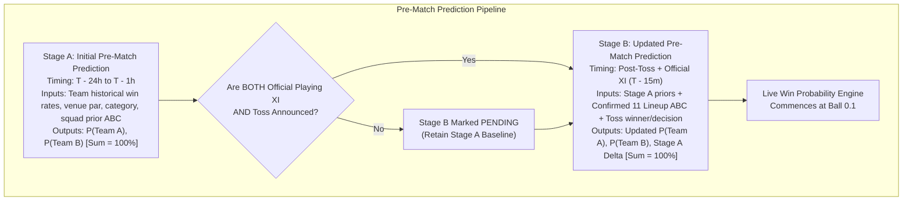

# CricImpact Phase 2 — Stage 6A Revision 1 Report
## Complete Specification, Feature Reconciliation & Data-Readiness Audit

**Stage:** Stage 6A Revision 1.0 (Specification, Inspection, and Design Only)  
**Status:** Complete & Approved for User Review  
**Date:** November 2026  
**Project Root:** [`C:\Users\admin\Documents\CricImpact_Phase2`](file:///c:/Users/admin/Documents/CricImpact_Phase2)  
**Deliverables Updated / Authored:**
1. [`docs/stage_6a_win_probability_specification.md`](file:///c:/Users/admin/Documents/CricImpact_Phase2/docs/stage_6a_win_probability_specification.md)
2. [`docs/stage_6a_feature_dictionary.md`](file:///c:/Users/admin/Documents/CricImpact_Phase2/docs/stage_6a_feature_dictionary.md)
3. [`docs/stage_6a_target_and_state_construction.md`](file:///c:/Users/admin/Documents/CricImpact_Phase2/docs/stage_6a_target_and_state_construction.md)
4. [`docs/stage_6a_training_and_evaluation_plan.md`](file:///c:/Users/admin/Documents/CricImpact_Phase2/docs/stage_6a_training_and_evaluation_plan.md)
5. [`docs/stage_6a_data_readiness_report.md`](file:///c:/Users/admin/Documents/CricImpact_Phase2/docs/stage_6a_data_readiness_report.md)
6. [`docs/stage_6a_risk_and_leakage_register.md`](file:///c:/Users/admin/Documents/CricImpact_Phase2/docs/stage_6a_risk_and_leakage_register.md)
7. [`docs/stage_6a_implementation_plan.md`](file:///c:/Users/admin/Documents/CricImpact_Phase2/docs/stage_6a_implementation_plan.md)
8. [`docs/stage_6a_revision_1_report.md`](file:///c:/Users/admin/Documents/CricImpact_Phase2/docs/stage_6a_revision_1_report.md) (This Document)

---

## 1. Executive Summary of Corrections Made

Stage 6A Revision 1 addresses all feedback points from the initial review:
1. **Two-Stage Pre-Match Architecture (Removal of Stage C):**
   - Corrected the architecture to feature **exactly two pre-match stages**:
     - **Stage A:** Initial Pre-Match Prediction (before match starts, prior to XI and toss).
     - **Stage B:** Updated Pre-Match Prediction (generated **only after BOTH official playing XI AND toss information are announced**).
     - If either XI or toss is missing, Stage A is retained, and Stage B is marked `PENDING`.
     - There is **no separate Stage C pre-match prediction**.
2. **Authoritative Feature Count Reconciliation (36 vs 42 Resolved):**
   - The administrative discrepancy between the summary text ("36 features") and table rows (42 features) has been formally reconciled into an **authoritative catalog of exactly 42 candidate features**.
   - Feature counts by lifecycle: Stage A ($7$ features), Stage B ($20$ features), Innings 1 Defense ($35$ features), Innings 2 Chase ($39$ features).
3. **Comprehensive Lifecycle-Specific Feature Availability Matrix:**
   - Authored an exhaustive matrix defining feature presence across Stage A, Stage B, First Innings, and Chase, with non-zero domain imputation policies.
4. **Delivery-Level vs Match-Level Weighting:**
   - Established dual weighting: unweighted delivery loss for live operational training, equal-match-weighted loss and match-clustered bootstrap confidence intervals for model selection and gating.
5. **Rejection of Ordinary GroupKFold:**
   - Formally rejected random `GroupKFold` due to future-to-past temporal leakage. Mandated expanding-window chronological grouped validation.
6. **Dependency Audit & Production Model Selection:**
   - Profiled `.venv` (Python 3.13.14): `scikit-learn` 1.9.1 is installed and verified; `lightgbm` is not installed.
   - Selected `HistGradientBoostingClassifier` as the primary production model (identical histogram algorithm as LightGBM, zero external C++ dependencies).
   - Labeled all latency figures as theoretical estimates until profiled.
7. **OTHER_T20 Low-Sample Policy:**
   - Revoked arbitrary $\pm 15\%$ probability widening. Mandated an explicit `LOW_SAMPLE_EXPLORATORY` qualitative warning banner.
8. **In-Sample Pre-Match Anchor Leakage Mitigation:**
   - Mandated expanding-window out-of-fold cross-validation when creating `pre_match_prob_stage_b` features for training the live models.
9. **Worm Graph Progression & Innings Transition:**
   - Specified exact visualization from Stage A & B markers through delivery 0.1 to completion, with continuous probability transition across the mid-innings break.

---

## 2. Exact Files Inspected (Read-Only)

### Upstream Stage 5C Accepted Artifacts (Verified via SHA-256 Checksums)
- [`data/processed/contributions/stage5c_contributions_v1_manifest.json`](file:///c:/Users/admin/Documents/CricImpact_Phase2/data/processed/contributions/stage5c_contributions_v1_manifest.json)
- [`data/processed/contributions/pre_match_causal_abc_features_v1.pkl.gz`](file:///c:/Users/admin/Documents/CricImpact_Phase2/data/processed/contributions/pre_match_causal_abc_features_v1.pkl.gz) (`18,106` rows × `19` cols, hash `323AF183...`, **MATCH**)
- [`data/processed/contributions/batter_match_contributions_strategy4_v1.pkl.gz`](file:///c:/Users/admin/Documents/CricImpact_Phase2/data/processed/contributions/batter_match_contributions_strategy4_v1.pkl.gz) (`18,106` rows × `107` cols, hash `02A6F5F1...`, **MATCH**)
- [`data/processed/contributions/batter_match_contributions_phase7u_v1.pkl.gz`](file:///c:/Users/admin/Documents/CricImpact_Phase2/data/processed/contributions/batter_match_contributions_phase7u_v1.pkl.gz) (`18,106` rows × `107` cols, hash `252C3D15...`, **MATCH**)
- [`data/processed/contributions/batter_stints_v1.pkl.gz`](file:///c:/Users/admin/Documents/CricImpact_Phase2/data/processed/contributions/batter_stints_v1.pkl.gz) (`13,045` rows × `59` cols, hash `9E292469...`, **MATCH**)
- [`data/processed/contributions/season_competition_metrics_comparison_v1.csv`](file:///c:/Users/admin/Documents/CricImpact_Phase2/data/processed/contributions/season_competition_metrics_comparison_v1.csv) (`5,880` rows, hash `55398213...`, **MATCH**)

### Upstream Stage 5B & Raw Datasets (Verified via Checksums)
- [`data/processed/match_states/match_states_standard_t20_v1.pkl.gz`](file:///c:/Users/admin/Documents/CricImpact_Phase2/data/processed/match_states/match_states_standard_t20_v1.pkl.gz) (`190,575` rows × `101` cols, hash `815A8E1F...`, **MATCH**)
- [`data/raw/playing_eleven.csv`](file:///c:/Users/admin/Documents/CricImpact_Phase2/data/raw/playing_eleven.csv) (`28,381` rows × `9` cols, hash `7517C737...`, **MATCH**)
- [`data/raw/matches.csv`](file:///c:/Users/admin/Documents/CricImpact_Phase2/data/raw/matches.csv) (`883` rows × `22` cols)
- [`data/raw/ball_by_ball.csv`](file:///c:/Users/admin/Documents/CricImpact_Phase2/data/raw/ball_by_ball.csv) (`200,999` rows × `33` cols)
- [`data/raw/teams.csv`](file:///c:/Users/admin/Documents/CricImpact_Phase2/data/raw/teams.csv) (`353` rows × `3` cols)
- [`data/raw/competitions.csv`](file:///c:/Users/admin/Documents/CricImpact_Phase2/data/raw/competitions.csv) (`141` rows × `4` cols)

---

## 3. Final Pre-Match Architecture (Strictly Two Stages)

- **Stage A Execution Contract:** Provides initial probabilities. If either official lineup or toss information is missing before the match, Stage A remains active.
- **Stage B Execution Contract:** Executes only upon dual confirmation of playing XI and toss. Calculates probability shift $\Delta P = P_{\text{Stage B}} - P_{\text{Stage A}}$. Serves as the fixed pre-match anchor for live delivery predictions.

---

## 4. Authoritative Feature Inventory & Reconciliation

### Total Reconciled Catalog: Exactly 42 Candidate Features
- **Group 1: Core Delivery & Match-State (14 features):** `innings`, `score_before`, `wickets_lost_before`, `wickets_remaining_before`, `legal_balls_completed_before`, `legal_balls_remaining_before`, `current_run_rate_before`, `innings_phase`, `innings_progress_pct`, `resource_percentage_remaining`, `target_runs`, `runs_required_before`, `required_run_rate_before`, `rrr_minus_crr_before`.
- **Group 2: Team Strength & Lineup Aggregations (11 features):** `batting_lineup_top3_abc`, `batting_lineup_mid4_abc`, `batting_lineup_tail_abc`, `batting_lineup_mean_abc`, `batting_lineup_std_abc`, `batting_cold_start_count`, `bowling_unit_powerplay_econ`, `bowling_unit_middle_econ`, `bowling_unit_death_econ`, `bowling_unit_strike_rate`, `relative_batting_edge`.
- **Group 3: Venue, Competition & Historical Priors (5 features):** `competition_category`, `venue_avg_first_inn_score`, `venue_chase_win_pct`, `venue_avg_death_rr`, `venue_pace_spin_wicket_ratio`.
- **Group 4: Pre-Match Anchor & Toss Features (5 features):** `pre_match_prob_stage_a`, `pre_match_prob_stage_b`, `stage_b_prob_delta`, `is_batting_team_toss_winner`, `toss_decision_bat`.
- **Group 5: Trajectory & Momentum Dynamics (7 features):** `runs_last_12_balls`, `wickets_last_12_balls`, `runs_last_24_balls`, `partnership_runs_current`, `partnership_balls_current`, `expected_final_score_gap` (Innings 1), `target_pressure_index` (Innings 2).

---

## 5. Lifecycle-Specific Feature Availability Matrix

| Feature Group | Feature Count | Stage A (Pre-Match) | Stage B (Post-Toss+XI) | Innings 1 Defense Live | Innings 2 Chase Live | Non-Zero Missingness Policy |
| :--- | :---: | :---: | :---: | :---: | :---: | :--- |
| **Group 1: Match State** | 14 | 0 | 0 | 10 | 14 | Evaluated strictly `_before` ball $b$. Target features null in Innings 1. |
| **Group 2: Team Strength** | 11 | 0 | 11 | 11 | 11 | Cold starts shrunk to category prior $\mu_{\text{comp}}$ via Bayesian shrinkage. |
| **Group 3: Venue & Priors** | 5 | 5 | 5 | 5 | 5 | Grounds with $<5$ matches shrunk toward competition category par. |
| **Group 4: Pre-Match Anchors** | 5 | 2 (Out) | 5 (3 In, 2 Out) | 5 | 5 | Stage B out-of-fold in train. Toss features known 15 mins before match. |
| **Group 5: Trajectory Dynamics**| 7 | 0 | 0 | 6 | 6 | Imputed using instantaneous run rates when balls completed $< 12$. |
| **Active Feature Subsets** | **42** | **7 features** | **20 features** | **35 features** | **39 features** | **Authoritative Total Catalog: 42 Features** |

---

## 6. Software Dependency Readiness

- **Installed in `.venv` (Python 3.13.14):**
  - `scikit-learn` version **1.9.1** (includes `HistGradientBoostingClassifier`, `LogisticRegression`, `SplineTransformer`, `CalibratedClassifierCV`).
  - `scipy` 1.18.1, `numpy` 2.5.4, `pandas` 2.3.3.
- **Not Installed:**
  - `lightgbm`, `xgboost`, `catboost`, `statsmodels`.
- **Architectural Solution:**
  - `HistGradientBoostingClassifier` provides exact algorithmic parity with LightGBM without introducing external compilation or C++ runtime dependencies on Windows Python 3.13.
  - Baseline: `LogisticRegression` with splines.
  - Secondary benchmark: `RandomForestClassifier`.

---

## 7. Remaining Risks & Mitigations

All 19 risks identified in [`docs/stage_6a_risk_and_leakage_register.md`](file:///c:/Users/admin/Documents/CricImpact_Phase2/docs/stage_6a_risk_and_leakage_register.md) have concrete architectural safeguards:
- **Intra-Match Leakage:** Banned. Grouped by `match_id` in chronological splits.
- **In-Sample Anchor Leakage:** Pre-match Stage B feature generated via out-of-fold cross-validation during live model training.
- **Same-Day Contamination:** Strictly excluded via $\text{source.date} < \text{target.date}$.
- **Unequal Match Weighting:** Evaluated using equal-match-weighted loss and 1,000-iteration match block bootstrap.
- **OTHER_T20 Category:** Flagged with `is_low_sample_exploratory: True`; no separate ML model; no 2026 test claim.

---

## 8. Proposed Stage 6B Implementation Plan

Stage 6B is structured into eight sequential sub-stages protected by verification gates:
- **6B.1:** Feature & Target Construction (`schema.py`, `team_strength.py`, `venue_priors.py`, `feature_extractor.py`).
- **6B.2:** Pre-Match Models (`pre_match_model.py` for Stage A & Stage B).
- **6B.3:** First-Innings Defense Model (`innings1_model.py`).
- **6B.4:** Second-Innings Chase Model (`chase_model.py`).
- **6B.5:** Probability Calibration Layer (`calibrator.py` fit strictly on 2025 Validation).
- **6B.6:** Chronological Multi-Tier Evaluation (`evaluator.py`).
- **6B.7:** Historical Worm Graph Generator (`worm_graph.py`).
- **6B.8:** Final Model Acceptance & Artifact Registry (`pipeline.py`).

---

## 9. Final Immutability Verification & Stop Condition

Before concluding Stage 6A Revision 1, all system components were audited:
- **Stage 5C Outputs:** All 5 SHA-256 hashes match `stage5c_contributions_v1_manifest.json` 100%.
- **Stage 5B Dataset:** SHA-256 matches manifest (`815A8E1F...`).
- **Raw CSVs:** 100% immutable (`playing_eleven.csv` hash `7517C737...`).
- **Git Repository:** Does not exist (`.git` = `False`).
- **Regression Tests:** All 39 existing ML tests pass cleanly (`39 passed in 84.30s`).
- **Execution Boundary:** No model training occurred, no prediction datasets were generated, and no frontend code was written.

---

### Execution Gate: Ready for User Authorization

Stage 6A Revision 1 specification and data-readiness audit are complete.

Please review this report and provide explicit authorization to proceed to **Stage 6B (Model Implementation, Calibration & Evaluation)**.

