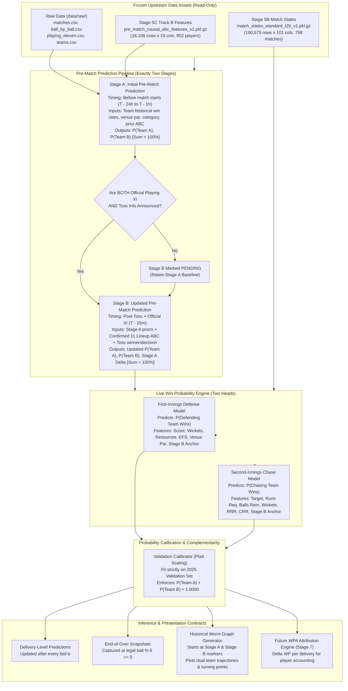

# CricImpact Phase 2 — Stage 6A Revision 1: Win Probability Engine Specification

**Document:** Stage 6A System Specification (Revision 1.0)  
**Status:** Approved Specification (Planning & Design Only — Stage 6A)  
**Author:** AI Architecture & Data Science Agent  
**Date:** November 2026  
**Project Root:** [`C:\Users\admin\Documents\CricImpact_Phase2`](file:///c:/Users/admin/Documents/CricImpact_Phase2)  
**Companion Documents:**
- [`stage_6a_feature_dictionary.md`](file:///c:/Users/admin/Documents/CricImpact_Phase2/docs/stage_6a_feature_dictionary.md)
- [`stage_6a_target_and_state_construction.md`](file:///c:/Users/admin/Documents/CricImpact_Phase2/docs/stage_6a_target_and_state_construction.md)
- [`stage_6a_training_and_evaluation_plan.md`](file:///c:/Users/admin/Documents/CricImpact_Phase2/docs/stage_6a_training_and_evaluation_plan.md)
- [`stage_6a_data_readiness_report.md`](file:///c:/Users/admin/Documents/CricImpact_Phase2/docs/stage_6a_data_readiness_report.md)
- [`stage_6a_risk_and_leakage_register.md`](file:///c:/Users/admin/Documents/CricImpact_Phase2/docs/stage_6a_risk_and_leakage_register.md)
- [`stage_6a_implementation_plan.md`](file:///c:/Users/admin/Documents/CricImpact_Phase2/docs/stage_6a_implementation_plan.md)
- [`stage_6a_revision_1_report.md`](file:///c:/Users/admin/Documents/CricImpact_Phase2/docs/stage_6a_revision_1_report.md)

---

## 1. Executive Summary & Objective

The objective of Stage 6 is to build a reliable, context-aware, well-calibrated **Cricket Win Probability Prediction Engine** for Twenty20 (T20) cricket across the Indian Premier League (**IPL**), Twenty20 Internationals (**T20I**), and other domestic/franchise T20 leagues (**OTHER_T20**).

The engine must evaluate the probability of Team A and Team B winning across three core operational phases:
1. **Stage A — Initial Pre-Match Prediction:** Before the match starts, prior to confirmed playing XI and toss.
2. **Stage B — Updated Pre-Match Prediction:** Generated **only after BOTH the official playing XI and toss information (winner + decision) are announced**. There is no separate third pre-match stage.
3. **Live Win Probability Engine:** Continuous, context-aware updating after every delivery transition, branching into:
   - **First-Innings Defense Model:** Evaluating resource exhaustion, run-rate velocity, and expected final score relative to venue par.
   - **Second-Innings Chase Model:** Evaluating target pressure, runs required, balls remaining, wickets in hand, and required vs current run rate deficit.
4. **Historical Win Probability Worm Graph:** Turn-by-turn match trajectory reconstruction for completed fixtures, plotting win probabilities for both teams alongside turning points, high-leverage deliveries, and phase transitions.

### Non-Negotiable Stage 6A Constraints
- **Zero Model Training:** No machine learning model is trained in Stage 6A.
- **Zero Live Predictions:** No prediction datasets or live runtime outputs are generated.
- **Zero Frontend Code:** No visualization or dashboard application code is implemented.
- **Zero Prior Stage Mutation:** Raw CSV files (`data/raw/`), Stage 4 ingestion, Stage 5A specifications, Stage 5B match-state outputs (`match_states_standard_t20_v1.pkl.gz`), and Stage 5C Track B contribution outputs (`pre_match_causal_abc_features_v1.pkl.gz`, `batter_match_contributions_strategy4_v1.pkl.gz`) remain 100% immutable and read-only.
- **Strict Temporal Causality:** Any feature evaluated at time $t$ uses exclusively information available strictly prior to time $t$.

---

## 2. End-to-End System Architecture

The following diagram illustrates the complete system architecture of the CricImpact Phase 2 Win Probability Engine. Exactly **two pre-match stages** exist (Stage A and Stage B), directly followed by the live in-play engine.



---

## 3. Operational Lifecycles & Prediction Modes

### 3.1 Stage A — Initial Pre-Match Prediction
**Timing: Before the match starts (T - 24 hours to T - 1 hour).**

Generate initial win probabilities prior to the availability of the official playing XI and toss information.

- **Available Information:**
  - Historical franchise/national team win rates (trailing 2 seasons, strictly prior dates).
  - Head-to-head records where historically meaningful (IPL and bilateral T20I).
  - Venue historical first-innings par score and chasing win percentage.
  - Competition category (`IPL`, `T20I`, `OTHER_T20`).
  - Historical Strategy 4 ABC ratings for rostered squad members.
- **Unavailable Information:**
  - Official playing XI (squad only; match selection unconfirmed).
  - Toss winner and toss decision (`bat` vs `field`).
  - Delivery-level match information.
- **Output Contract:**
  - Team A win probability $P_A \in [0.0, 1.0]$.
  - Team B win probability $P_B = 1.0 - P_A$.
  - Prediction timestamp, data cutoff timestamp, and feature metadata.

### 3.2 Stage B — Updated Pre-Match Prediction
**Timing: After BOTH the official playing XI and toss information are announced (T - 15 minutes).**

Stage B is generated **only when both conditions are satisfied**:
1. Official playing XI is announced and validated for both teams.
2. Toss winner and toss decision are officially confirmed.

If either condition is unfulfilled, Stage B remains `PENDING`, and Stage A is retained as the active operational prior.

- **Available Information:**
  - All eligible Stage A features.
  - Confirmed 11 players per team from `playing_eleven.csv`.
  - Lineup-aggregated prior ABC features: Top-order (1–3), Middle-order (4–7), Tail (8–11), and Lineup Standard Deviation.
  - Active Impact Player designation in IPL (substitute-in vs substitute-off).
  - Toss winner (`matches.toss_win_team_id`).
  - Toss decision (`matches.toss_opted`: `bat` vs `field`).
  - Innings designation: Team 1 (Batting First) vs Team 2 (Bowling First).
- **Output Contract:**
  - Updated Team A win probability $P_{A, \text{Stage B}}$.
  - Updated Team B win probability $P_{B, \text{Stage B}} = 1.0 - P_{A, \text{Stage B}}$.
  - Reference Stage A probability $P_{A, \text{Stage A}}$.
  - Probability movement: $\Delta P = P_{A, \text{Stage B}} - P_{A, \text{Stage A}}$.
  - Confirmed lineup metadata, toss metadata, and prediction timestamp.

### 3.3 Live Win Probability Engine (Delivery-Grain Updates)
Upon commencement of play (ball 0.1), the match enters the live engine. Winning probabilities update after every delivery transition $b$.

#### Strict Complementarity Guarantee
The internal models evaluate probability from the perspective of the **current batting team**:
$$P_{\text{bat}}(b) = P(\text{Current Batting Team Wins} \mid \mathcal{S}_b)$$

For any match-fixed reference team (e.g. Team A / Home Team):
$$P(\text{Team A Wins} \mid \mathcal{S}_b) = \begin{cases} P_{\text{bat}}(b) & \text{if } \text{batting\_team\_id}(b) = A \\ 1.0 - P_{\text{bat}}(b) & \text{if } \text{bowling\_team\_id}(b) = A \end{cases}$$
$$P(\text{Team B Wins} \mid \mathcal{S}_b) = 1.0 - P(\text{Team A Wins} \mid \mathcal{S}_b)$$

This conversion guarantees that $\forall b, \quad P(\text{Team A Wins}) + P(\text{Team B Wins}) \equiv 1.0000$.

### 3.4 Historical Win Probability Worm Graph
For completed matches, the engine reconstructs the entire chronological probability progression:
- **Visual Structure:** Dual lines (Team A primary color, Team B secondary color) across over progression ($0.0$ to match completion).
- **Pre-Match Anchors:** Plotted at $t = \text{Pre-Match Stage A}$ and $t = \text{Pre-Match Stage B}$ before ball 0.1.
- **Mid-Innings Boundary:** Vertical dashed transition line at 20.0 overs (or all-out). Displays first-innings total and Target $T = \text{Score} + 1$. Win probability remains continuous across the innings break.
- **Annotations:** Wicket markers, high-leverage turning points ($|\Delta P| \ge 0.10$), and final outcome checkpoint ($100\%$ for winner, $0\%$ for loser).

---

## 4. Two-Head Model Architecture

Cricket dynamics fundamentally diverge between Innings 1 and Innings 2:

```
                                 Incoming Delivery State
                                            │
                                  Innings == 1 or 2?
                                            │
                    ┌───────────────────────┴───────────────────────┐
                    │                                               │
             Innings == 1                                    Innings == 2
                    │                                               │
        ┌───────────▼───────────┐                       ┌───────────▼───────────┐
        │  Innings 1 Defense    │                       │  Innings 2 Chase      │
        │  Model Head           │                       │  Model Head           │
        └───────────┬───────────┘                       └───────────┬───────────┘
                    │                                               │
                    │ Raw P(Batting Win)                            │ Raw P(Chasing Win)
                    │                                               │
                    └───────────────────────┬───────────────────────┘
                                            │
                                ┌───────────▼───────────┐
                                │   Calibration Layer   │
                                │  (Platt Scaling /     │
                                │   Isotonic Regression)│
                                └───────────┬───────────┘
                                            │
                                ┌───────────▼───────────┐
                                │ Output Transformation │
                                │ P(Bat) + P(Bowl) = 1  │
                                │ P(A) + P(B) = 1       │
                                └───────────────────────┘
```

### 4.1 Innings 1 Head: Resource & Trajectory Model
- **Target:** $P(\text{Batting Team Wins Match} \mid \text{Innings 1 State})$.
- **Core Concept:** Evaluates whether the batting side's projected total will exceed the opponent's chasing capacity given the venue par total.
- **Key Drivers:** `score_before`, `wickets_remaining_before`, `legal_balls_remaining_before`, `current_run_rate_before`, `expected_final_score_gap`, `venue_avg_first_inn_score`, `pre_match_prob_stage_b`.

### 4.2 Innings 2 Head: Target Pressure & Chase Model
- **Target:** $P(\text{Chasing Team Wins Match} \mid \text{Innings 2 State})$.
- **Core Concept:** Evaluates whether the chasing side can score $R_{\text{req}}$ runs within $B_{\text{rem}}$ balls with $W_{\text{rem}}$ wickets remaining.
- **Key Drivers:** `target_runs`, `runs_required_before`, `legal_balls_remaining_before`, `wickets_remaining_before`, `required_run_rate_before`, `rrr_minus_crr_before`, `target_pressure_index`, `pre_match_prob_stage_b`.
- **Terminal States:**
  - $R_{\text{req}} \le 0 \implies P(\text{Chase Win}) = 1.0000$ (target achieved).
  - $W_{\text{rem}} == 0 \text{ and } R_{\text{req}} > 0 \implies P(\text{Chase Win}) = 0.0000$ (all out).
  - $B_{\text{rem}} == 0 \text{ and } R_{\text{req}} > 0 \implies P(\text{Chase Win}) = 0.0000$ (overs exhausted).

---

## 5. Stage 5C ABC Integration & Causal Guarantees

The accepted Stage 5C Track B dataset (`pre_match_causal_abc_features_v1.pkl.gz`) is ingested read-only:
- **Strict Temporal Rule:** $\text{source.match\_date} < \text{target.match\_date}$.
- **Exclusion of Same-Day Matches:** Same-day doubleheaders are strictly excluded from prior windows.
- **Zero Target Contamination:** Current-match ABC, final match scores, and match results are prohibited from entering feature sets.
- **Cold-Start Shrinkage:** When a player has no prior appearances (`is_abc_cold_start == True`), their prior ABC is shrunk to the competition-category baseline $\mu_{\text{comp}}$.

---

## 6. OTHER_T20 Category Policy & Limitations

- **Empirical Sample:** OTHER_T20 contains only 28 matches total (15 in 2024, 13 in 2025, 0 in 2022, 2023, or 2026).
- **Mandatory Policy:**
  1. Do NOT train an OTHER_T20-specific machine learning model.
  2. Do NOT silently borrow IPL or T20I models without explicit disclosure.
  3. Predictions generated for OTHER_T20 must carry an explicit qualitative metadata warning: `is_low_sample_exploratory: True`.
  4. Arbitrary $\pm 15\%$ probability widening is explicitly revoked. The engine reports the model point estimate alongside the qualitative low-sample warning banner.
  5. The 2026 test split contains 0 OTHER_T20 matches; no independent test validation is claimed for this category.

---

## 7. Model Candidates & Dependency Readiness

An audit of the Phase 2 virtual environment (`.venv`, Python 3.13.14) establishes the following dependency status:
- **`scikit-learn` (v1.9.1):** Installed and verified.
- **`scipy` (v1.18.1):** Installed and verified.
- **`numpy` (v2.5.4) & `pandas` (v2.3.3):** Installed and verified.
- **`lightgbm` / `xgboost` / `catboost`:** **NOT installed**.

### Candidate Evaluation & Architectural Selection

| Candidate | Status in `.venv` | Tabular Nonlinearities | Calibration Quality | Training Latency | Inference Latency | Decision |
| :--- | :---: | :--- | :--- | :--- | :--- | :--- |
| **Logistic Regression + Splines** | Installed (`sklearn`) | Moderate (requires manual spline terms) | Native log-odds | < 5 sec (theoretical) | < 0.1 ms (theoretical) | **Baseline Benchmark** |
| **HistGradientBoostingClassifier** | Installed (`sklearn`) | **Outstanding** (LightGBM-equivalent histogram GBDT) | High (with Platt scaling on Val) | < 25 sec (theoretical) | < 0.3 ms (theoretical) | **Primary Production Model** |
| **Random Forest** | Installed (`sklearn`) | Good (resilient to outliers) | Moderate (under-predicts wings) | ~ 60 sec (theoretical) | ~ 2.0 ms (theoretical) | **Secondary Benchmark** |
| **LightGBM** | **Not Installed** | Outstanding | High | < 20 sec (theoretical) | < 0.3 ms (theoretical) | **Optional Alternate (Subject to Stage 6B Install Approval)** |

*Note on Latency:* All training and inference latency figures are labeled theoretical until empirically profiled on the production dataset in Stage 6B.

---

## 8. Win Probability Added (WPA) Design Preview (Stage 7)

Although WPA is deferred to Stage 7, the delivery-grain prediction dataset generated by Stage 6 will store `wp_batting_before` and `wp_batting_after` on every row:

$$\text{Team WPA}_b = P(\text{Batting Team Wins} \mid \mathcal{S}_b) - P(\text{Batting Team Wins} \mid \mathcal{S}_{b-1})$$

- **Player Attribution Principle:**
  - Team WPA is a match-level state change.
  - Striker and bowler attribution cannot simply split Team WPA 50/50.
  - Normal deliveries: Striker receives $+\text{WPA}_{\text{bat}}$, bowler receives $-\text{WPA}_{\text{bat}}$.
  - Extras (wides, no-balls): Bowler receives entire negative penalty.
  - Run-outs / Fielding: Fielder receives direct attribution.
